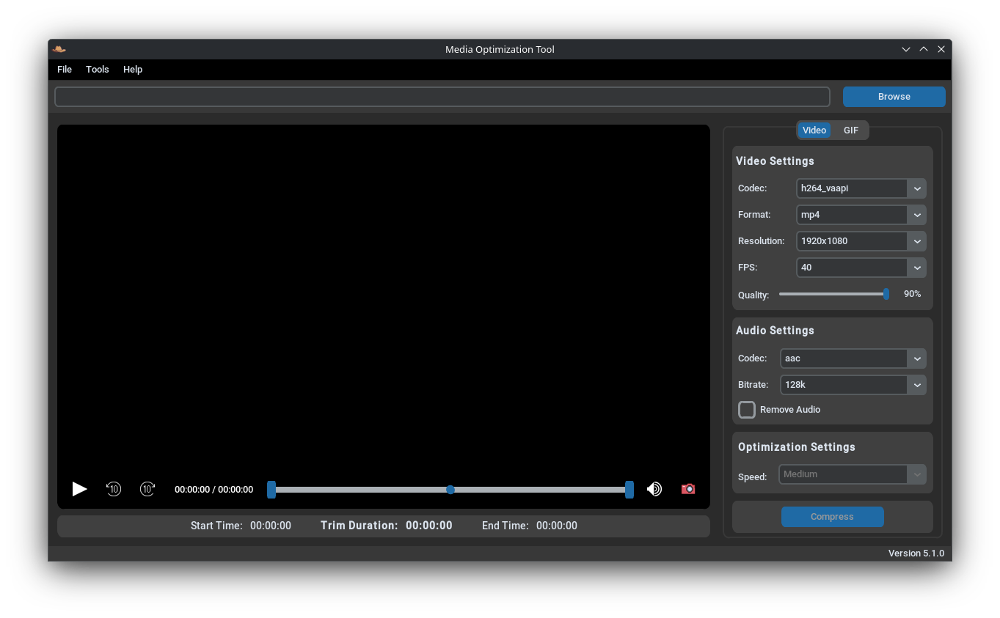

<h1 align="center">
Media Compression App
</h1>

---

The Media Compression App is a Python based graphical interface for FFmpeg, allowing 
the user to select options for compressing or converting video files. Other functionality 
includes trimming videos, saving screenshots and creating GIFs. The app can detect the 
users GPUs to show hardware based codec options (H264, HEVC). Other options the dynamically 
update based on codec the user selected, or based on the videos resolution and frame rate.
For easier trimming, the app uses VLC for video playback.

    <picture>
        
    </picture>

The app is built of the CustomTkinter UI library by Tom Schimansky for a modern look that 
sets its appearance based on system appearance and scaling settings. For all 3rd party 
libraries and licenses, view the [thirdpartylicenses.txt](./thirdpartylicenses.txt)